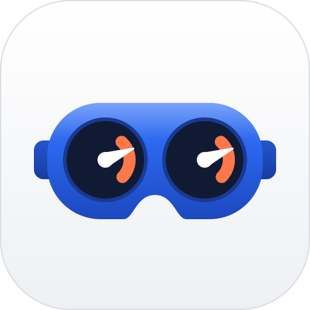

<p align="center">
  <picture>
    <source media="(prefers-color-scheme: dark)" srcset="docs/logo/overpressure.svg">
    
  </picture>
</p>

<h1 align="center">overpressure</h1>

<p align="center">
  <b>Linux and Valve's SteamOS VR session on standalone VR headsets.</b>
</p>

<p align="center">
  <a href="#quick-start">Quick start</a>
  &nbsp;&middot;&nbsp;
  <a href="#headsets">Headsets</a>
  &nbsp;&middot;&nbsp;
  <a href="docs/tool.md">The tool</a>
  &nbsp;&middot;&nbsp;
  <a href="docs/adding-a-headset.md">Add a headset</a>
  &nbsp;&middot;&nbsp;
  <a href="LICENSE">Unlicense</a>
</p>

overpressure turns standalone VR headsets into SteamOS headsets: Valve's Steam Frame kernel and VR session
(SteamVR in gamescope) with drivers for each headset's own lenses, cameras, sensors and controllers. Your Steam
library runs on it, Windows games through Proton and FEX, Android games through Valve's Lepton, and PC games over
Steam Link. One installer builds the system on your computer from public downloads and puts it on the headset;
the way back to the headset's own system is one click away.

Each headset is a folder under `devices/` on one shared tool. The PICO 4 is the first; more are welcome
([adding a headset](docs/adding-a-headset.md)).

> [!WARNING]
> A beta for owners who accept the risk. It replaces the headset's system, erases its data and ends what is left of
> its warranty. The installer backs your headset up first: keep that backup. Not affiliated with Valve or any
> headset's maker.

## Headsets

| Codename | Headset | Status |
| --- | --- | --- |
| [phoenix](devices/phoenix/README.md) | PICO 4 (2022, Snapdragon XR2) | Installs and runs on the tested unit: both lenses at 90 and 72 Hz, head and controller tracking, the room view, sound, Wi-Fi and Bluetooth, sleep, Steam with Proton and FEX, Android games, Steam Link, the way back to PICO OS. Heavy games run at what the GPU allows ([roadmap](devices/phoenix/docs/roadmap.md)) |

Each headset's README says which units and firmware have run it, what it needs and what is open. The project
publishes no image and no vendor file: you build your own from the makers' public downloads.

## Quick start

**You need** the headset and a USB-C data cable, a computer with Windows, macOS or Linux, and
[Docker](https://docs.docker.com/get-docker/) or [Podman](https://podman.io) running (the build's Linux side runs in
a container). On Linux also your distribution's Tk for Python (`python3-tk`; Fedora `python3-tkinter`, Arch
`tk`), or the window looks rough, and its Android udev rules (Arch `android-udev`, Debian `android-udev-rules`)
for USB access to the headset; the installer's first stage checks both and says what to install. The disk space and time the first build takes are in the headset's README.

1. Download the release zip and unpack it.
2. Start the installer: double-click `Install.cmd` (Windows) or `Install.command` (macOS; the first time
   right-click, *Open*), or run `sh install.sh` (Linux). It fetches its own Python into `cache/`; nothing is
   installed on the computer.
3. Accept the disclaimer, choose your headset, then what to do: **Install**, **Upgrade** or **Restore to stock**.
   Each is a few stages with one button each, and goes on where it stopped when started again.

## For developers

Everything the window does, the command line does too ([docs/tool.md](docs/tool.md)); Python 3.9+, from the
repository root:

```sh
python -m overpressure devices       # the supported headsets
python -m overpressure doctor        # what this computer lacks, with fixes
python -m overpressure gui           # the window (--advanced: every step, one click each)
python -m overpressure install       # the installer in a terminal; also upgrade, restore
python -m overpressure steps         # the headset's steps and the command lines they run
python -m unittest                   # every host test, in seconds; make lint: ruff and ty
```

`overpressure/` is the generic tool: the installer, the window, the build container, the formats Android-based
headsets share. `devices/<codename>/` holds one headset each: its plan, images and drivers. A new headset adds a
folder and registers itself ([adding a headset](docs/adding-a-headset.md)). Device data, vendor files and builds
stay in the ignored `backup/`, `assets/`, `cache/`, `out/` and `.env`. See [CONTRIBUTING.md](CONTRIBUTING.md) and
[SECURITY.md](SECURITY.md).

## License

The project's own code is in the public domain ([the Unlicense](LICENSE)). What comes from elsewhere keeps its
license ([THIRD-PARTY.md](THIRD-PARTY.md)): the kernel's sources are under the GPL, the Monado driver under
BSL-1.0.
